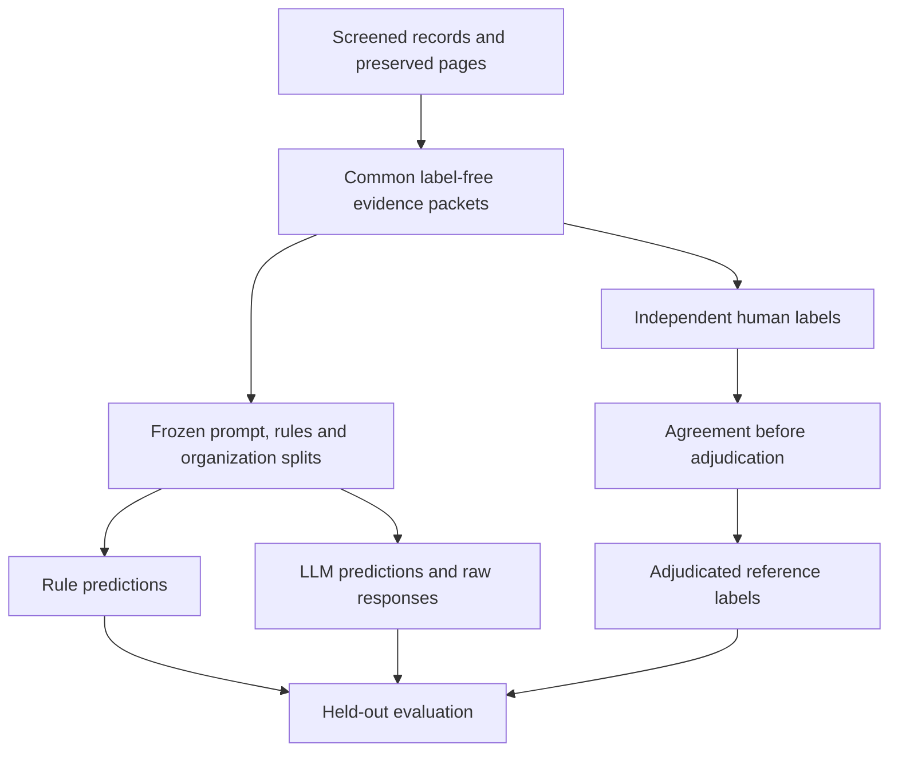

# Classification implementation and appendix draft

Status: the bounded five-record cohort and shared-input prediction run are described in PROGRESS_2026-11-08.md and docs/EXECUTION_PROTOCOL_2026-11-08.md. There is no human agreement estimate or research performance result. All records remain pending independent human field verification. The exact prompt, settings and outputs are preserved with the experiment artifacts; current software checks are reported in the progress file.

## Information parity

Both classifiers receive the same label-free packet for each eligible deployment: organization, AI use case, Moroccan location, selected source quotations, preserved surrounding contexts, provenance and available publication dates, plus the common evidence cutoff and outdated threshold. Context is reconstructed from source-page offsets; if reviewed context offsets are absent, the complete preserved page is supplied and this fallback is recorded. Record/evidence fields are allowlisted. Human labels, annotation rationale and other classifier predictions are excluded.

The rule baseline scans the complete supplied context, rather than just the short quotation, and uses supplied dates for its recency check. Other metadata is available to both methods; the baseline does not automatically interpret every field. Equal information availability does not imply equal semantic capabilities. Neither method fetches linked websites. Eligibility screening is separate from stage classification.

The bilingual baseline recognizes stage cues, redirects prospective trials to announced, and conservatively abstains on negated or mixed cues. Its recency rule marks a record outdated only when every source has a known publication date and even the latest is older than the prespecified threshold. Publication dates are a proxy: it cannot reliably distinguish an old event in a newer article, resolve source originality or attribution, or interpret arbitrary stage transitions. Report these limitations; do not tune on held-out errors. Full-page fallbacks can add unrelated statements and should be inspected before freezing.

## Guide alignment and fixed configuration

The prompt encodes the four stages and the outdated, conflicting, ambiguous and unverified reason codes in the November 8 draft guide. Planned pilots and product releases without evidence of use are announced. Missing dates remain unknown. Prior calibration organizations are excluded from test when the calibration-ID manifest is supplied. A provided split manifest is checked for exact record coverage and organization separation. Known publication dates after the cutoff are rejected.

The user delegated scope choices. The execution uses a 2026-11-08 evidence cutoff, a two-year evidence-age threshold, one development organization and four new test organizations. Generic model releases, infrastructure and digital systems without an explicit AI/recognition application were excluded. The revised proposal specifies gpt-4.1-mini-2025-04-14 and temperature 0; the implementation uses a 1500-token output cap. Missing exact source dates remain null. The Crédit du Maroc context includes a March 2025 management-report header; this is not a verified online publication date. All four test sources are French, and no bilingual-performance inference is possible.

Explicitly unconfirmed candidates are rejected from study freezes. A separately marked development_smoke_test snapshot allows provisional data only in development and cannot be scored as a research evaluation. The new prediction_pending_human_review purpose permits prospective development/test predictions only for explicit assistant-screened eligible records. It preserves screening decisions outside the shared inputs and blocks research scoring until human field review is resolved. PDF line wraps are normalized for cue matching without changing the original quoted substring, so a newline between a negation and its stage cue does not discard the negation.

The exact prompt is `PROMPT` in `morocco/experiment.py`, copied verbatim into frozen `config.json` and `model_requests.jsonl`. Include that frozen prompt in the submitted appendix rather than a paraphrase or later source-code version. The model, explicit settings, guide version, cutoff, rule/evidence source hashes and artifact manifest are stored with the run. Unspecified generation parameters use provider defaults and must not be described as fixed zero-temperature settings.

## Flow

Development labels may inform guide/prompt/rule revisions. Freeze final versions before the held-out comparison. Preserve original labels, adjudication decisions and split provenance separately. Human review procedures, blinding and language competence are not established by software tests.

## Model execution

The standard-library adapter uses the [OpenAI Responses API structured-output interface](https://developers.openai.com/api/docs/guides/structured-outputs?api-mode=responses). Explicitly choose and verify the model through a development call. No model substitution or outside retrieval is performed. A strict JSON schema requests record ID, label, supporting quote, evidence index, insufficiency reason code and a brief rationale. Exact quotations are checked against the shared context.

Raw responses, actual model identifiers, usage information when returned, request hashes and timestamps are retained. The complete_batch wrapper can finish only unattempted records after a validation failure while preserving the failed raw response. It exports accepted predictions and failures separately; a response failure is not a deployment-stage label. Transient transport/server failures have bounded retries; refusals, truncation or invalid outputs stop the run and remain visible. Resume reuses existing responses and checks the frozen identity. Report failures and interventions; do not silently discard items or resample until an answer looks desirable. A timeout can still have incurred a provider-side call even if no response was received.

## Actual development intervention

The first real model response predicted announced but reflowed a PDF quotation,
so strict substring validation rejected it. A separately frozen prompt revision
explicitly requires preserving line breaks and repeated spaces; it changes no
classification instruction, evidence, split, model setting or rule output.
The next response predicted announced and quoted the Idarati sentence exactly.
Both raw responses are retained. This is a development-format intervention,
not a silent retry, first-attempt success, or evidence of predictive accuracy.
The rule quotation refers to an adjacent marketplace; this attribution
limitation remains documented. That revised prompt was frozen unchanged for the bounded held-out execution.
The historical development outputs remain separate from this cohort.

## Execution failures and replication

The primary held-out batch had one response that degenerated into repeated null Unicode escapes and reached the output cap. The other three held-out responses and the development response passed validation. The failure remains in the primary batch. Before any additional calls, one complete-cohort technical replication was declared: the same five records, frozen inputs, model, prompt and settings, with one new response per record and no third attempt for validation failures. Primary and replication outputs remain separate; first successful outputs are never pooled. This post-failure replication is a disclosed reliability diagnostic, not a prespecified accuracy experiment. Automatic approval review initially blocked the additional transmission; the user then authorized continuation. The complete replication saved five new responses: development 1/1 and test 3/4 passed validation, with the same failure. Accepted labels matched across rounds. Both rounds are retained separately, and no third attempt was made. This establishes repeated behavior under the frozen configuration, not accuracy. No prediction is human gold.

## Evaluation reporting

Response-failure accounting was fixed after observing the repeated formatting failure and before any independent human labels were available. Use the primary first-round attempts for the main comparison. Keep every test record: a failed response is a false negative for its gold class and a prediction for none of the four stages. The confusion matrix adds an `invalid_output` audit column; macro-F1 still averages only the original four classes. Report accepted-output coverage and failure count alongside scores. Do not treat failures as insufficiently_supported, exclude them, or pool first successful outputs across rounds. Bootstrap samples preserve the failure flags. The classifier/rule definitions remain frozen.

Report independent raw agreement and unweighted Cohen's kappa before adjudication. Compare both methods against adjudicated labels on the same test records. Report fixed four-class macro-F1, per-class precision/recall/F1/support and confusion matrices with gold labels in rows and predicted labels in columns. Absent classes contribute zero to fixed-label macro-F1; disclose coverage. Report undefined kappa or ratios as undefined.

False-operational rate retains the existing project definition: false operational predictions divided by all operational predictions (one minus operational precision when the denominator is nonzero). Give numerator and denominator. This differs from a false-positive rate whose denominator is all non-operational gold records.

The paired organization-cluster bootstrap estimates macro-F1 intervals and the model-minus-rules difference. Few independent organizations make intervals unstable; no interval is produced with fewer than two. Review false-operational predictions for semantic support. An exact quote match does not establish that a sentence supports the predicted stage.

## Populate after the real run

| Item | Authoritative artifact |
|---|---|
| Eligible N, split IDs, organizations, class counts | frozen inputs/splits and test gold |
| Model, prompt, cutoff, settings, recency threshold | frozen config.json |
| Actual model and execution status | raw responses and run_metadata.json |
| Independent agreement | agreement.json |
| Performance and intervals | final-results/results.json |
| Error inspection | false_operational_audit.jsonl plus human notes |

Do not use synthetic test values. Change this appendix's status to completed research only after the corresponding artifacts exist.
