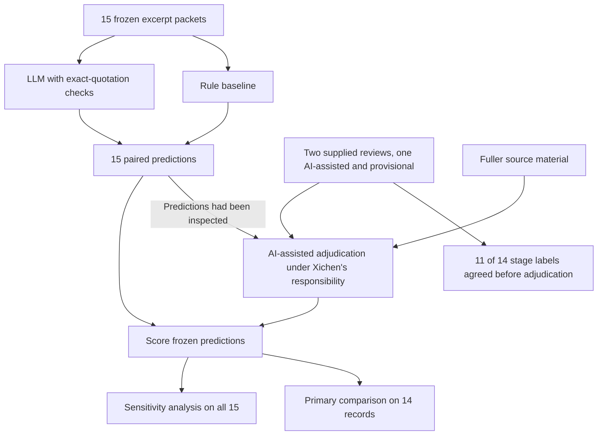

# Appendix. Matched-excerpt deployment-stage pilot

On November 9, 2026, the rule baseline and language model classified 15 supplied Moroccan deployment claims as of November 8. The review labels had already been inspected during preparation, so all 15 records were marked as development data. Each method received the same evidence packet for each record. The primary comparison uses 14 of the 15 completed predictions from each method.

## What the classifiers saw

The 15 packets contained 18 supplied excerpts from 17 distinct URLs. Seventeen excerpts were in French and one in English. Each excerpt's `context` and `quote` fields contained the same text. Three records contained two excerpts each. The rules read the supplied packet directly. The API received that packet serialized with Python's `json.dumps(record, ensure_ascii=False)` as its `input`. The source URLs were metadata. The API call had no retrieval tools, and the evidence packets omitted reviewer notes, labels and full source pages.

| Packet fields | Contents |
| --- | --- |
| Record | `record_id`, `organization_id`, `organization`, `use_case`, `moroccan_location`, `sector`, `as_of_date`, `outdated_years`, `evidence` |
| Each evidence item | `document_id`, `page`, `start`, `end`, `quote`, `context`, `context_scope`, `source_date`, `source_date_as_supplied`, `source_url`, `source_type`, `language`, `original_verified` |

The run preserved a month-only date in `source_date_as_supplied` and left its exact `source_date` null. All 18 `original_verified` values were null. The frozen input JSONL file has SHA-256 `36d0b573291b9e6c04c689da07eef82dd8bbf660c77730fdc0bfe477f5fcb02a`.

## Classifier settings and prompt

| Setting | Value used |
| --- | --- |
| Model | `gpt-4.1-mini-2025-04-14` via `POST /v1/responses` |
| Explicit generation settings | `temperature=0`, `max_output_tokens=1500`, `store=false` |
| Output format | Strict JSON Schema named `deployment_stage`. All six fields in the prompt were required. Extra fields were disallowed. |
| As-of date and evidence age | `2026-11-08`, `outdated_years=2` |
| Frozen versions | Guide `2026-11-08-execution-v1`, rule baseline `draft-4-shared-context-wraps` |
| Classifier code | [Rules](https://github.com/noahchang06/morocco-project11/blob/1257e4ec2a68353c2d3f76e5b9a787c1b3d2083f/morocco/study.py), [prompt](https://github.com/noahchang06/morocco-project11/blob/1257e4ec2a68353c2d3f76e5b9a787c1b3d2083f/morocco/experiment.py), and [API payload, schema and validation](https://github.com/noahchang06/morocco-project11/blob/1257e4ec2a68353c2d3f76e5b9a787c1b3d2083f/morocco/run_model.py) at the execution commit |

[Exact API instructions in plain text](prompt.txt). All 15 requests used this UTF-8 string unchanged (SHA-256 `fba2c2a7e9eba44f97bcc0ad67f0812b417625fbdc91bcf4a14b4da382d06feb`). The prompt treats eligibility as screened. The team subsequently adjudicated eligibility for scoring, including the R01 exclusion.

Both classifiers received the same date fields. The rules returned `insufficiently_supported / outdated` before cue matching whenever every excerpt had an exact source date and the newest date preceded November 8, 2024. The LLM received the two-year policy in the prompt and applied it inconsistently. This difference affects interpretation of the score gap.

## From the supplied records to the reported comparison

Of 15 original records, 14 had stage labels in both supplied review files. Agreement was 11/14 (78.6%) with unweighted Cohen's κ of 0.664. One initial review explicitly described itself as AI-assisted and provisional. The statistic describes agreement between these two reviews. The reference labels were finalized after model-output inspection under Xichen's responsibility, with access to fuller source material. Independent human confirmation of each decision was not recorded.

All 15 LLM responses passed the format, field, reason-code and verbatim-quotation checks. For a nonempty quote, the validator required an exact substring of the indexed evidence. An empty quote was permitted for an insufficiently supported classification. Semantic support still required evidence review. No saved attempt was resampled. The team excluded R01 from both primary score calculations after determining that the in-scope proof-of-life workflow had been discontinued. The all-15 sensitivity analysis counted R01 as insufficiently supported with reason `outdated`; both analyses used the original predictions.
